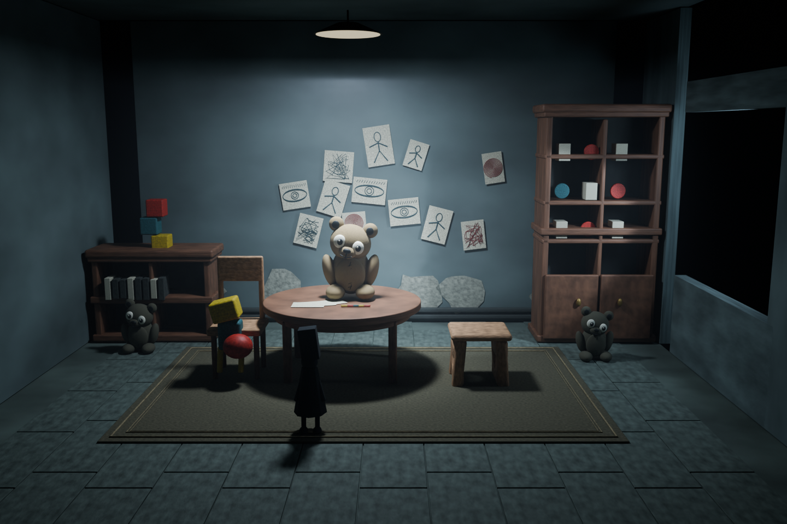
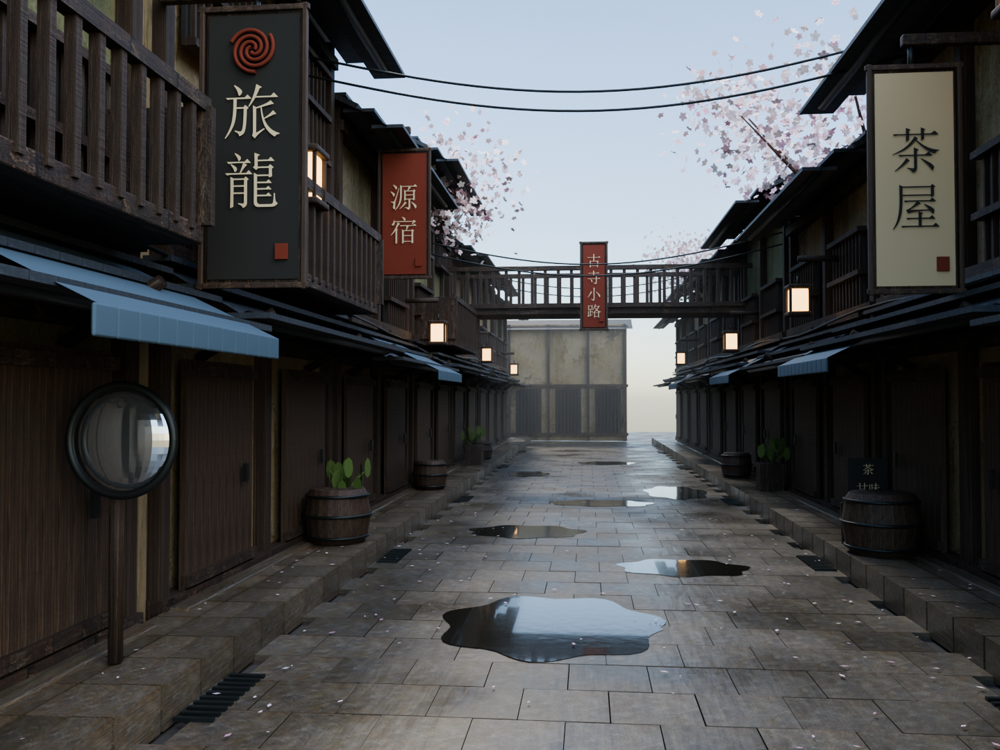

# Blender 单图场景实验项目

将一张 2D 氛围图转成可编辑的 Blender 场景，并保留分析、阶段渲染、修改证据、多视角和可重开工程。本项目目前有三套学习案例（包含室内的两次独立制作）；它们展示可执行工序，仍与参考图存在明显美术差异。

**Agent 开工先读 [AGENTS.md](AGENTS.md)，并按其中顺序学习规范与两套案例。**

## 两套场景

| 案例 | 过程预览与说明 | 离线成片工程 | 实时浏览工程 |
|---|---|---|---|
| 玩偶房间 | [预览](scenes/TeddyRoom_Study/index.html) · [说明](scenes/TeddyRoom_Study/README.md) | [scene.blend](scenes/TeddyRoom_Study/scene.blend) | [scene_realtime.blend](scenes/TeddyRoom_Study/scene_realtime.blend) |
| 雨后樱花街 | [预览](scenes/SakuraLane_Study/index.html) · [说明](scenes/SakuraLane_Study/README.md) | [scene_cycles.blend](scenes/SakuraLane_Study/scene_cycles.blend) | [scene_realtime.blend](scenes/SakuraLane_Study/scene_realtime.blend) |





本地 HTML 直接用浏览器打开即可，不依赖服务器。每套目录内保留原图、布局图、阶段 `.blend`、源码、渲染和验证记录。EEVEE 版本用于清爽浏览，Cycles 用于成片；二者的反射、间接光和体积表现有差异。

## 规范与学习入口

- [完整 Pipeline](docs/PIPELINE.md)：每阶段怎样做、交付什么、如何决定进入下一阶段。
- [两套案例的实际经验](docs/CASE_LESSONS.md)：出现的问题、修正措施、仍未解决的限制。
- [公开资料整理指南](learning/materials/Blender_Agent_场景制作与视觉验收指南.md)：此前整理的方法与参考链接，保留原文及整理日期；来源没有在本次迁移中逐项重新联网核验。
- [任务模板](templates/README.md)：需求、状态与视觉评审记录。
- [迁移说明](docs/MIGRATION.md) · [逐文件原始校验清单](docs/migration_manifest.json) · [项目校验报告](docs/project_verification.json)。

## 目录约定

```text
AGENTS.md                   所有 agent 的开工入口
docs/                       工序、经验、迁移与校验记录
scenes/TeddyRoom_Study/      室内学习包的展开版本与可编辑工程
scenes/SakuraLane_Study/     室外学习包的展开版本与可编辑工程
learning/materials/         公开参考资料归纳文档
learning/packages/          按当前案例目录重新生成的完整学习包
learning/packages/original/  迁移前的历史 ZIP，原样保留
archive/run_logs/           两次制作运行日志、历史备份
templates/                  新任务文档模板
tools/                      打包、迁移和验证工具
```

当前学习包：[室内完整包](learning/packages/TeddyRoom_Study_完整学习包.zip)、[室外完整包](learning/packages/SakuraLane_Study_完整学习包.zip)。包内有同名场景顶层目录；排除自动备份 `*.blend1`。自动备份仍保留在场景目录，未因打包排除而删除。`original/` 中的历史室内包早于实时版本保存，不作为最新成果。

修改案例后，在项目根目录运行以下命令刷新并检查学习包：

```powershell
.\tools\build_learning_packages.ps1
.\tools\verify_project.ps1
```

这两条命令验证文件与包的一致性，不代替新修改后的 Blender 重开、渲染与美术评审。相关程序见 [tools/README.md](tools/README.md)。

## 已验证的本机环境

案例制作使用 Blender **4.2.3 LTS**，可执行文件：

```text
D:\Program Files\Blender Foundation\Blender 4.2\blender.exe
```

Cycles 使用 RTX 4060 Laptop 8 GB / OptiX，脚本有 CPU 回退。其他机器应先确认版本、设备和字体。室外从零重建招牌依赖 Windows `simsun.ttc`；已保存工程已打包字体和纹理。源码按自身目录求资源位置，场景目录可整体搬移。具体从零执行顺序见各案例 README；会清空场景或重复追加的模式必须按说明执行。

这里的 3D 制作依赖本地 Blender，而非仅靠 Web。MCP 可以替代部分调用通道，但不能替代工程保存、实际渲染和视觉审查。

## 成果边界

两套案例采用设计尺度与补全布局，未恢复原地点的唯一真实三维结构。室内的角色与家具、室外的建筑变化与植被等仍需精修；背面和内部没有按完整关卡建设。尚未验证游戏引擎导入、碰撞、导航或目标设备性能。未提供参考图相似度百分比。

用户参考图保留用于本地学习，权利归原权利人。生成材质与程序化模型的制作来源在各案例中说明；本项目不据此赋予参考作品的商业使用许可。

## 2026-11-10：同一熊房间从空场景重建

新增 [三图与工序预览](scenes/TeddyRoom_Rebuild_20261110/index.html)、[制作说明](scenes/TeddyRoom_Rebuild_20261110/README.md)、[Cycles 工程](scenes/TeddyRoom_Rebuild_20261110/scene_cycles.blend)、[实时版](scenes/TeddyRoom_Rebuild_20261110/scene_realtime.blend)、[学习包](learning/packages/TeddyRoom_Rebuild_20261110_完整学习包.zip)。本版没有加载或修改第一版 3D 工程。重点增加可见物件清单、外观保留、原纸画内容与逐项视觉复核。新门槛见 [VISIBLE_CONTENT_GATE.md](docs/VISIBLE_CONTENT_GATE.md)。

