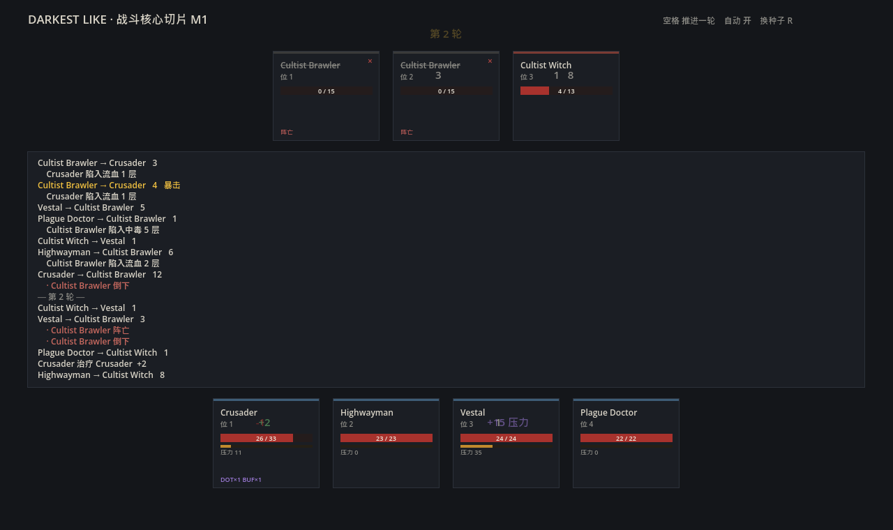

# M1 — 战斗核心垂直切片

用 M0 抽出的数据，在 Godot 4 里跑通「4 英雄 vs 3 怪物」的完整回合结算。
规则层是纯 GDScript 类，不挂节点、不依赖场景，可以脱离引擎单测。



## 这一版是什么、不是什么

**是**：一套能自己跑完一场战斗的规则内核，伤害/命中/暴击/行动序/效果结算全部实现，
并有 113 项断言 + 120 条跨语言交叉验证用例守着。

**不是**：可玩的游戏。没有输入、没有关卡、没有小镇、没有美术。界面只是色块占位，
目的是让规则能被肉眼检查。

## 分层

```
src/core/            规则层（纯 RefCounted，无节点）
  dd_rng.gd          确定性随机数（xorshift32），用于跨语言逐位对账
  dd_rules.gd        rules.json 的类型化包装
  dd_db.gd           数据索引（英雄/怪物/效果/buff）
  combatant.gd       战斗单位：基础层 / 修正层 / 状态层
  damage_formula.gd  伤害与命中公式（全静态纯函数）
  turn_scheduler.gd  每轮先攻重掷 + 排序
  effect_resolver.gd 效果结算（两趟：攻击前收集修正、攻击后施加状态）
  battle.gd          编排：回合循环、决策、事件广播

src/view/            表现层（订阅事件，不含规则）
tests/               测试与战报工具
tools/ref_impl.py    伤害公式的 Python 参考实现
```

**规则层不认识「画面」**。`battle.gd` 只往 `events` 数组里推事件字典
（`attack` / `miss` / `effect` / `death` / `stress` …），表现层自己去消费。
换美术、加动效、做回放，都不用碰规则。

## 伤害公式与运算顺序

顺序是移植里最危险的地方——写反了不会报错，只会「手感不对」。

```
1. 命中   hit  = clamp(ACC - DODGE, 0, 0.95)
2. 暴击   crit = rng() < CRIT
3. 基础   raw  = lerp(dmg_low, dmg_high, rng())
4. 修正   mult = 1 + Σ(修正)          ← 加算
5. 倍率   dmg  = raw × mult × (暴击 ? 1.5 : 1)
6. 减伤   dmg ×= (1 - PROT) × (1 + 受伤加成)
7. 取整   floor(dmg + 0.5)
```

几个必须在意的点：

- **英雄与怪物的 `dmg` 语义不同**。英雄的 `dmg: 0.0` 是叠在武器伤害上的百分比修正；
  怪物 `dmg: [2,4]` 是绝对区间。同名不同义。
- **第 4 步是加算不是连乘**。十字军惩击基础修正 0%、对邪物 +15%，打邪物应为 ×1.15。
  真正的判别点在多条件叠加：+15% 与 +50% 同时命中时，加算得 ×1.65、连乘得 ×1.725。
  用 20 点基础伤害可以把这个差异钉死（33 vs 35），测试里就是这条断言。
- **条件修正来自 effect 的 `monsterType` / `keyStatus`**。数据里有 66 条这样的效果，
  例如「+15% 对邪物」「+50% 对已被标记的目标」。它们必须在掷伤害**之前**收集。

## 站位编码

数据里是位串，不是坐标：

| 写法 | 含义 |
|---|---|
| `launch 21` | 从己方 1、2 号位发动 |
| `target 12` | 命中敌方 1、2 号位单体 |
| `target ~12` | 敌方 1、2 号位**全体**（AOE） |
| `target @1234` | 目标是**友方**任选一人 |
| `target @~1234` | 友方全体 |

`~` 是 AOE，`@` 是敌我标记——`@` 这一点最初被漏掉，靠「治疗技能全都往敌人身上放」
这个反常现象才查出来。解析后统一成 `mask & (1 << rank)`，在 Godot 里天然顺手。

## 怎么验证的

三层，逐层加严：

**一、公式单测（硬断言，可对照游戏本体）**

十字军 L0：武器 6–12、惩击命中 85%、暴击 3%、闪避 5%。
- 打普通目标伤害只能出现 6…12 这 7 个值
- 打邪物（+15%）只能出现 7…14
- 命中 85% − 闪避 5% = 80%；ACC 再高也封顶 95%

**二、数据一致性**
英雄/怪物引用的 1189 条效果全部可解析；十字军 5 阶装备逐字段对齐源文件。

**三、跨语言交叉验证（最有价值的一层）**
`tools/ref_impl.py` 是伤害公式的**独立第二实现**（Python），两套实现共享同一串随机数
（xorshift32，逐位对齐），对 120 条参数随机的用例比对 hit / crit / damage / raw / mult。
任何一处系数写错、顺序颠倒、随机数转录错位，这里立刻红。

这条思路的意义：一个公式只写一遍，测试再怎么断言都只是在验证「我以为」，不是「它正确」。
写第二遍才会暴露转录错误。

**四、整场战斗回归**
同种子两次跑完整场，状态快照必须逐字节一致；20 个种子必须全部分出胜负；
英雄生命不为负、怪物死亡即归零、压力只落在英雄身上。

## 假设清单（诚实交代）

数据给了参数，没给算法。下面每一条都是**推断**，不是源码还原。按置信度分级：

| 项 | 我的实现 | 置信度 | 依据 |
|---|---|---|---|
| 伤害修正加算 | `1 + Σ(mods)` | 高 | 面板显示值与加算吻合；连乘会在多条件叠加时明显偏高 |
| 取整方式 | `floor(x+0.5)` | 中 | 无法从数据区分 round / floor / ceil，只有边界值才能试出 |
| 先攻 | `速度 + rand(0..8)` | 中 | `initiative_base 8`；「含两端」无法确认 |
| 同先攻 tie-break | 速度 → 阵营交替 → 站位 | **低** | 完全在 exe 内，纯近似 |
| 眩晕判定 | `clamp(效果概率 - 眩晕抗性, 0, 1)` | 中 | 抗性字段存在，减法是最自然的解释 |
| AOE 逐目标掷骰 | 每个目标单独判命中/暴击/伤害 | 低 | 也可能整体掷一次；观感差别小 |
| DOT 结算时机 | 回合末统一跳 | 中 | 与 `duration` 语义一致，具体时点未验证 |
| 怪物 AI 评分 | 期望伤害 + 控制/压力估值 | **低** | `monster_brain` 只给 id，权重全在 exe 里 |

最后两条是最大的不确定性。AI 尤其明显——现在的实现是「能用、看起来合理」，
离 DD1 的行为特征（优先集火残血、优先控治疗）还有距离。

## 已知未实现

按对「一场战斗像不像 DD1」的影响排序：

1. **守护 / 反击**：状态记了，但被守护时改打守护者、反击的触发都没接
2. **位移**：push/pull 只记录不执行，站位不变
3. **召唤 / 变形 / 生命链接 / 共享血量**：数据里都在（`extra` 字段），逻辑没写
4. **压力崩溃与美德**：压力只累积到 200，没有 100 判定、没有折磨/美德
5. **惊袭**：走廊/房间的遭遇进入方式没接
6. **光照**：0–100 的火把值不在战斗内
7. **饰品 / 怪癖**：数据齐备，未接入战斗属性计算

## 怎么跑

```bash
GODOT="D:/XT/godot/Godot_v4.7.2-stable_win64_console.exe"

# 跑测试（113 项断言，含跨语言对账）
"$GODOT" --headless --path . --script res://tests/run_tests.gd

# 打一份可读战报
"$GODOT" --headless --path . --script res://tests/dump_battle.gd

# 开界面（空格推进一轮，A 开关自动，R 换种子）
"$GODOT" --path .

# 改了公式后，先重新生成 Python 侧基准，再跑测试
python tools/ref_impl.py
```

## 下一步（M2 起点）

M1 证明了这套规则能正确跑起来。M2 要做的不是加内容，而是**换数值**：

1. 拿 `data/balance_curves.json` 里的生成器参数，重新生成一套自己的数值
2. 同一批测试原样再跑一遍，看规则还在不在
3. 把 `data/*.json` 换成自己的内容表——规则层不用改一行

`DdDb` 是唯一的数据入口，`DdRules` 是唯一的常量入口。换数值就是从这两个口子灌新数据。
