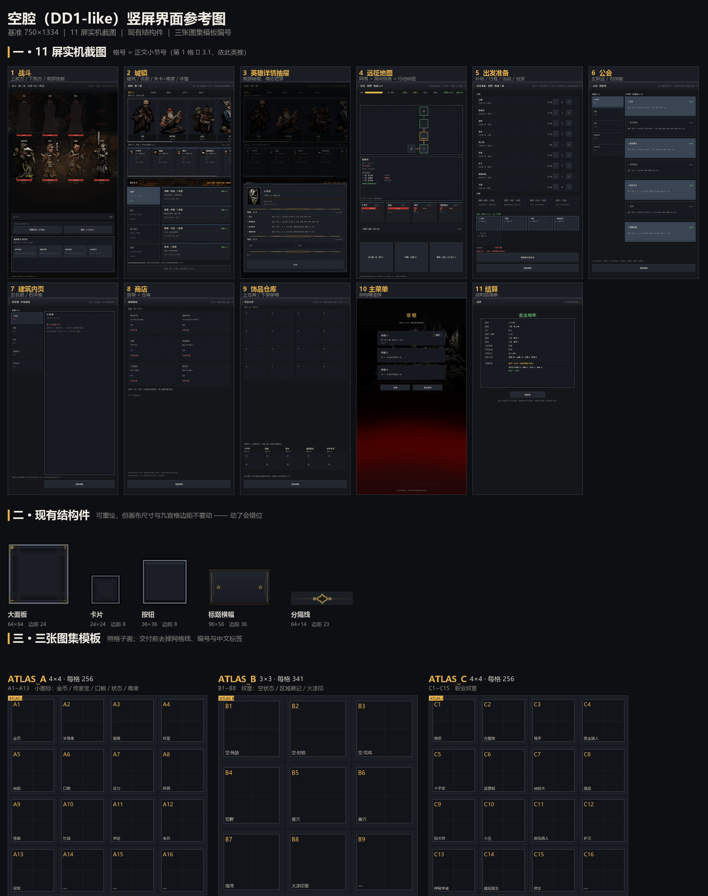

# 《空腔》界面美术资源需求书

> **给接手的 AI 出图方**：这份文档是自包含的。
> 你不需要读代码、也不需要看项目，按 **第 2、3 节的规格** 出图即可。
> 第 5 节是「要新增什么」，第 6 节是「交付格式」。

---

## 0. 一句话说清这是什么

一款**暗黑地牢（Darkest Dungeon）风格**的回合制地牢探索游戏，**竖屏手机 750 × 1334**。
界面全部由代码自绘（纯色矩形 + 1px 线），目前只有程序生成的简单边框，
**缺装饰性美术**。英雄与建筑立绘用的是原作素材，所以 UI 必须能与之共存。

---

## 1. 视觉方向（硬性，不符合的图会被退回）

### 1.1 参考坐标

- **主参考**：Darkest Dungeon 1 的 UI —— 铁与黄铜、木刻版画、脏污、低饱和
- **不是**：二次元手游、扁平 Material、玻璃拟态、霓虹赛博、明亮清新

### 1.2 色板（**必须使用这些值**，界面其它部分都是这几个色）

| 用途 | 色值 | 说明 |
|---|---|---|
| 页面底色 | `#14161a` | 最深，所有面板浮在它上面 |
| 面板底 | `#1b1e24` | 常规面板 |
| 面板底（深） | `#161920` | 内嵌区域 |
| 面板描边 | `#2c313a` | 1px 分隔用 |
| 按钮底 | `#23272f` | |
| 按钮悬停 | `#2f3540` | |
| 按钮按下 | `#3a4453` | |
| 主文字 | `#d9d4c7` | 米白，**不要纯白** |
| 次级文字 | `#8b8a84` | |
| 微弱文字 | `#5d5f5c` | |
| 强调金 | `#f0c040` | 暴击/高亮 |
| 暖金 | `#e0b24a` | 光源/稀有 |
| 危险红 | `#c8695f` | 警告、受伤 |
| 生命红 | `#a8322d` | 血条 |
| 成功绿 | `#6fbf73` | 可执行 |
| 压力金 | `#c08a2e` | 压力条 |
| 我方蓝 | `#3e5c76` | 我方标识 |
| 敌方红 | `#7a3b34` | 敌方标识 |
| 护甲紫 | `#9d7bd8` | 属性加成 |

### 1.3 材质与笔触

- **铁/黄铜**：暗部偏黑（#0a0b0d），亮部到 #8a7440 为止，**不要亮到发白**
- **木刻感**：边缘可以有细小的缺口、掉漆、不均匀的粗细
- **脏**：可以有锈斑、积灰，但不要脏到看不清形状
- **阴影**：用「内阴影 + 外描边」表现厚度，不要用高斯模糊的浮起投影

### 1.4 禁止

| 禁止 | 原因 |
|---|---|
| 任何文字、字母、数字、标点 | 游戏内是中文，图里带字会重复 |
| 写实人脸、具体人物 | 涉及角色设定，不在本次范围 |
| 高饱和（荧光绿/亮紫/纯红） | 会破坏暗色调 |
| 圆角矩形 / 胶囊形 | 本项目所有控件是直角 |
| 纯黑背景 | 必须是透明背景 |
| 渐变光晕、外发光 | 那是特效层的事，不是 UI |
| 3D 渲染感、塑料高光 | 要平面手绘/版画质感 |

---

## 2. 技术规格（硬性）

### 2.1 通用

- **格式**：PNG，RGBA，8bit
- **背景**：**透明**（alpha = 0）。若生成工具不支持透明，请用纯品红 `#FF00FF` 铺底并说明
- **颜色模式**：sRGB
- **抗锯齿**：边缘可以有半透明像素
- **不要**：不要在图里烘焙投影到透明区域外

### 2.2 两类图，处理方式完全不同

#### A 类 · 九宫格结构件（边框、底板、按钮）

这类图会被程序切成 3×3 拉伸，**必须满足**：

```
┌────────┬─────────────────┬────────┐
│  角    │      上边        │  角    │
│ 固定   │   只横向拉伸      │ 固定   │
├────────┼─────────────────┼────────┤
│  左边  │      **中间**     │  右边  │
│ 只纵向 │   会被拉到任意大   │ 只纵向 │
├────────┼─────────────────┼────────┤
│  角    │      下边        │  角    │
└────────┴─────────────────┴────────┘
```

- **四角**：可以有花纹，但花纹**不得跨越**切分线
- **四边**：只能是沿一个方向的直线/渐变，**不能有周期花纹**（拉伸会变形）
- **中间**：**必须纯色或完全透明**。有任何花纹都会被拉成一片模糊
- **交付时必须注明 corner size**（切分点距边缘多少像素）

#### B 类 · 独立图形（纹章、图标、印章）

- 不需要拉伸，按实际显示尺寸的 **2 倍** 出图（例如显示 96px 就出 192px）
- 图形居中，四周留 8% 透明边距
- 可以有任意复杂细节

### 2.3 命名与目录

```
交付根目录/
├── structure/         A 类（九宫格）
│   ├── panel.png
│   └── ...
├── ornament/          B 类（独立图形）
│   ├── emblem_empty_01.png
│   └── ...
└── README.txt         注明每个文件的 corner size／尺寸／用途
```

命名：`类别_用途_变体.png`，全小写，下划线分隔。

---

## 3. 现有界面与控件清单



> **这是全套界面唯一的参考图**，分三个区：
>
> | 区 | 内容 |
> |---|---|
> | **一** | 11 屏实机截图，2 行 6 列，左上角金色编号 **1 ~ 11**，与下面 3.1~3.11 的小节号一一对应 |
> | **二** | 现有 5 个结构件（大面板 / 卡片 / 按钮 / 标题横幅 / 分隔线），附尺寸与九宫格边距 |
> | **三** | 三张图集模板 ATLAS_A / B / C，格子里已标好编号 |
>
> 所有截图都是 **750 × 1334 实际运行画面**，可以直接量比例。
> 缩略图只用于看布局与配色，**精确尺寸以下面每张表的数值为准**。

### 3.1 战斗屏

> 位置：参考图 **一** 区第 1 格。

| 控件 | 用途 | 显示尺寸 | 状态 | 类型 | 现有资源 |
|---|---|---|---|---|---|
| 顶部标题条 | 回合数 / 光照 / 操作提示 | 750 × 56 | 1 | A 类横向 | `banner.png` 96×56，左右各 36 |
| 单位立绘 | 敌我各 3~4 个 | 高 240 | 待机/出招/受击/死亡 | 已有原作素材 | 不改 |
| 血条 | 每个单位脚下 | 104 × 11 | 4 档颜色 | B 类可做端头 | 无 |
| 压力条 | 血条下方 | 104 × 6 | 3 档 | 同上 | 无 |
| 选中/目标地环 | 单位脚下椭圆 | 108 × 28 | 3 态（选中金/目标绿/悬停灰） | B 类 | 无 |
| 日志摘要条 | 最近一条记录 | 702 × 44 | 常态/悬停/按下 | A 类 | `card.png` 24×24，边 8 |
| 次级操作行 | 调整站位 / 跳过 | 702 × 92（含标题） | 同上 | A 类 | 同上 |
| **技能格** | 4 列 × 2 行 | 每格约 166 × 80 | 常态/悬停/按下/已选 | A 类 | `btn.png` 36×36，边 12 |
| 目标提示文字 | 「选择目标」 | — | 1 | 纯文字 | — |

### 3.2 城镇屏（主界面）

> 位置：参考图 **一** 区第 2 格。

| 控件 | 用途 | 显示尺寸 | 状态 | 类型 | 现有资源 |
|---|---|---|---|---|---|
| 顶部标题条 | 周数 / 统计 | 750 × 56 | 1 | A 类横向 | `banner.png` |
| 资源条 | 金币 + 4 种传家宝数字 | 高 40 | 1 | 纯文字 | **需图标**（见 5.2） |
| 建筑卡 | 8 座建筑入口 | 190 × 300 | 常态/悬停/按下 | A 类 | `card.png` |
| 名册卡 | 5~15 个英雄 | 150 × 200 | 常态/悬停/按下 | A 类 | `card.png` |
| 关卡标题条 | 区域横幅 + 标题 | 702 × 48 | 1 | A 类横向 | `banner.png` |
| 区域卡 | 4 个区域切换 | 220 × 118 | 常态/悬停/按下/已选 | A 类 | `btn.png` |
| 难度卡 | 4 档任务 | 470 × 118 | 常态/悬停/按下/不可用 | A 类 | `card.png` |
| 底部大按钮 | 休整一周 | 702 × 48 | 常态/悬停/按下/禁用 | A 类 | `btn.png` |

### 3.3 英雄详情抽屉

> 位置：参考图 **一** 区第 3 格。

| 控件 | 用途 | 显示尺寸 | 状态 | 类型 | 现有资源 |
|---|---|---|---|---|---|
| 抽屉面板 | 半屏浮层 | 702 × 600~700 | 1 | A 类 | `panel.png` 64×64，边 24 |
| 分区线 | 技能/饰品/状态之间 | 654 × 14 | 1 | A 类横向 | `divider.png` 64×14，中间 18 |
| 头像框 | 英雄半身像外框 | 92 × 122 | 1 | B 类 | **需新增** |
| 饰品槽 | 2 个 | 约 320 × 44 | 空/已装 | A 类 | `card.png` |
| 关闭按钮 | 底部 | 654 × 56 | 3 态 | A 类 | `btn.png` |

### 3.4 远征地图屏

> 位置：参考图 **一** 区第 4 格。

| 控件 | 用途 | 显示尺寸 | 状态 | 类型 | 现有资源 |
|---|---|---|---|---|---|
| 顶部标题条 | 区域 / 进度 | 750 × 56 | 1 | A 类横向 | `banner.png` |
| 地图网格面板 | 房间图 | 702 × 340 | 1 | A 类 | `panel.png` |
| 房间格 | 走廊节点 | 约 78 × 60 | 当前/可走/已走/未知 | B 类 | **需新增**（见 5.3） |
| 房间信息面板 | 房间名/任务/走廊 | 702 × 300 | 1 | A 类 | `panel.png` |
| 队伍条 | 4 张卡 | 702 × 140 | 1 | A 类 | `card.png` |
| 行动按钮 | 点火把/休整/撤退 | 每约 226 × 104 | 3 态 + 禁用 | A 类 | `btn.png` |

### 3.5 出发准备屏

> 位置：参考图 **一** 区第 5 格。

| 控件 | 用途 | 显示尺寸 | 状态 | 类型 | 现有资源 |
|---|---|---|---|---|---|
| 补给行 | 10 种补给 × 数量 | 702 × 64 | 1 | A 类 | `card.png` |
| 加减按钮 | 每行右侧 | 40 × 40 | 3 态 | A 类 | `btn.png` |
| 行程卡 | 4 档任务 | 约 166 × 100 | 已选/未选/悬停 | A 类 | `card.png` |
| 出战卡 | 英雄选择 | 约 163 × 94 | 已选/未选/不可用 | A 类 | `card.png` |
| 出发/返回 | 底部 | 702 × 64 / 56 | 3 态 + 禁用 | A 类 | `btn.png` |

### 3.6 公会屏（技能装备）

> 位置：参考图 **一** 区第 6 格。

| 控件 | 用途 | 显示尺寸 | 状态 | 类型 | 现有资源 |
|---|---|---|---|---|---|
| 左·角色列表 | 5~15 人 | 212 宽 × 每行约 64 | 常态/悬停/已选 | A 类 | `card.png` |
| 右·技能卡 | 每角色 7 个 | 478 × 130 | 已装备/未装备/悬停 | A 类 | `card.png` |
| 返回按钮 | 底部 | 702 × 56 | 3 态 | A 类 | `btn.png` |

### 3.7 建筑内页（铁匠铺/疗养院/修道院/酒馆/商队/墓园共用）

> 位置：参考图 **一** 区第 7 格。

| 控件 | 用途 | 显示尺寸 | 状态 | 类型 | 现有资源 |
|---|---|---|---|---|---|
| 左·名册 | 212 宽 × 每行约 64 | — | 常态/悬停/已选 | A 类 | `card.png` |
| 右·操作面板 | 该建筑的功能区 | 478 × 约 520 | 1 | A 类 | `panel.png` |
| 返回按钮 | 底部 | 478 × 56 | 3 态 | A 类 | `btn.png` |

### 3.8 商店

> 位置：参考图 **一** 区第 8 格。

| 控件 | 用途 | 显示尺寸 | 状态 | 类型 | 现有资源 |
|---|---|---|---|---|---|
| 货架卡 | 2 列饰品 | 339 × 160 | 买得起/买不起/悬停 | A 类 | `card.png` |
| 仓库格 | 4 列 | 168 × 96 | 常态/悬停/按下 | A 类 | `card.png` |
| 返回按钮 | 底部 | 702 × 56 | 3 态 | A 类 | `btn.png` |

### 3.9 饰品仓库

> 位置：参考图 **一** 区第 9 格。

| 控件 | 用途 | 显示尺寸 | 状态 | 类型 | 现有资源 |
|---|---|---|---|---|---|
| 饰品格 | 4 列 | 168 × 110 | 常态/悬停/已选 | A 类 | `card.png` |
| 装备槽 | 每英雄 2 个 | 约 170 × 52 | 空/已装 | A 类 | `card.png` |
| 返回按钮 | 底部 | 702 × 56 | 3 态 | A 类 | `btn.png` |

### 3.10 主菜单

> 位置：参考图 **一** 区第 10 格。

| 控件 | 用途 | 显示尺寸 | 状态 | 类型 | 现有资源 |
|---|---|---|---|---|---|
| 存档槽 | 3 个 | 约 620 × 120 | 空/有档/悬停/确认删除 | A 类 | `card.png` |
| 设置/退出 | 底部 | 200 × 38 | 3 态 | A 类 | `btn.png` |

### 3.11 结算屏

> 已知问题：面板只占屏幕上 2/3，下方约 45% 是空白的。
> 这一屏将来会加「战利品插图」和「英雄受伤/阵亡列表」，出图时可以按「下方还有一条横向区域」预留。

> 位置：参考图 **一** 区第 11 格。

| 控件 | 用途 | 显示尺寸 | 状态 | 类型 | 现有资源 |
|---|---|---|---|---|---|
| 数值面板 | 战利品清单 | 702 × 385 | 1 | A 类 | `panel.png` |
| 返回按钮 | 底部 | 702 × 56 | 3 态 | A 类 | `btn.png` |

---

## 4. 现有图片资源（程序生成，规格基线）

> 位置：参考图 **二** 区。

下面这些是**当前已经在用**的图。可以在同一规格下重绘以提升质感，
但**尺寸与九宫格边距不能变**，否则要改代码。

| 文件 | 尺寸 | 九宫格边距 | 用途 | 特点 |
|---|---|---|---|---|
| `panel.png` | 64 × 64 | 24（四边） | 大面板 | 中间完全透明，四角有 8px 暖金短划 |
| `card.png` | 24 × 24 | 8（四边） | 小卡片 | 无角饰，只有边框 + 内阴影 |
| `btn.png` | 36 × 36 | 12（四边） | 按钮 | 上亮下暗，表现凸起 |
| `banner.png` | 96 × 56 | **横向** 36（左右固定，纵向不切） | 标题条 | 上下一对金线，左右端有折角 + 铆钉 |
| `divider.png` | 64 × 14 | **横向** 23 | 分区线 | 中间一枚菱形纹章，两侧细线渐隐 |
| `grain.png` | 128 × 128 | 平铺 | 全局颗粒 | 2px 块状噪点，alpha ≤ 11 |
| `stain.png` | 128 × 128 | 平铺 | 全局污渍 | 低频暗斑，alpha ≤ 40 |

---

## 5. 新增资源需求（本次重点）

> **全部按「图集（atlas）」交付，不要一张一张出。**
> 一张图里排好网格，风格和尺寸天然一致，比 26 张散图可靠得多。

### 5.0 三张图集

| 图集 | 交付文件名 | 画布 | 网格 | 每格 | 格内内容显示尺寸 | 数量 |
|---|---|---|---|---|---|---|
| **A** | `ATLAS_A.png` | 1024 × 1024 | 4 × 4 | 256 × 256 | 16 ~ 28 px | 13 个（余 3 空） |
| **B** | `ATLAS_B.png` | 1024 × 1024 | 3 × 3 | 341 × 341 | 56 ~ 120 px | 8 个（余 1 空） |
| **C** | `ATLAS_C.png` | 1024 × 1024 | 4 × 4 | 256 × 256 | 24 px | 15 个（余 1 空） |

**为什么是三张而不是一张**：显示尺寸差 5 倍（24px 对 120px）。
塞进同一张图，小的那些必然过小、细节全丢；按尺寸分表，每格都能画够细节。

> 位置：参考图 **三** 区，三张模板并排，格子、编号、中文标签、十字参考线都已排好 ——
> **直接照着画就行**（也可以自己按下面的坐标新建同样大小的画布）。

### 5.1 图集 A · 小图标（4×4）

| 编号 | 内容 | 显示尺寸 | 用在哪 |
|---|---|---|---|
| **A1** | 金币 | 24 | 城镇资源条、结算、商店价格 |
| **A2** | 半身像（传家宝） | 20 | 城镇资源条、结算 |
| **A3** | 画像（传家宝） | 20 | 同上 |
| **A4** | 纹章（传家宝） | 20 | 同上 |
| **A5** | 地契（传家宝） | 20 | 同上 |
| **A6** | 口粮 | 20 | 准备屏补给行、地图资源条 |
| **A7** | 压力 | 16 | 名册卡、详情抽屉 |
| **A8** | 疾病 | 16 | 同上 |
| **A9** | 负面怪癖 | 16 | 同上 |
| **A10** | 忙碌 | 16 | 同上 |
| **A11** | 学徒难度 | 28 | 难度卡左上角 |
| **A12** | 老兵难度 | 28 | 同上 |
| **A13** | 冠军难度 | 28 | 同上 |
| A14~A16 | 留空 | — | — |

**画面要求**

- A1 金币：磨损的金属币，正面有模糊压印（**不要数字、不要文字**）
- A2 半身像：小石雕胸像；A3 画像：带框小画；A4 纹章：小盾徽；A5 地契：系带羊皮卷
- A6 口粮：干面包或肉干
- A7 压力：裂开的心 / 扭曲的脑；A8 疾病：带斑点的瓶；A9 怪癖：扭曲小面具；A10 忙碌：沙漏
- A11~A13：分别用 **1 枚 / 2 枚 / 3 枚** 铆钉表达等级，不要写字

**统一要求**：单色为主（暗铁 `#2a2d33` + 暖金 `#8a7440`），
24px 下必须能认出剪影 —— **细节要少、轮廓要清楚**。

### 5.2 图集 B · 纹章与徽记（3×3）

| 编号 | 内容 | 显示尺寸 | 用在哪 |
|---|---|---|---|
| **B1** | 空状态·残缺 | 96 | 名册为空、饰品仓库为空 |
| **B2** | 空状态·封锁 | 96 | 任务板「一个人都带不动」 |
| **B3** | 空状态·完成 | 96 | 战役完成 |
| **B4** | 荒野徽记 | 56 | 城镇「副本关卡」区域卡 |
| **B5** | 墓穴徽记 | 56 | 同上 |
| **B6** | 巢穴徽记 | 56 | 同上 |
| **B7** | 海湾徽记 | 56 | 同上 |
| **B8** | 火漆印章 | 120 | 战役通关盖在结算屏 |
| B9 | 留空 | — | — |

**画面要求**

- **B1**：一面**残缺的盾形纹章**，中间有空洞或裂口，边缘剥落
- **B2**：同一面盾，被**铁链或封条交叉捆住**
- **B3**：同一面盾，完整但边缘磨损，中心一枚小星或十字
- 三张必须**同一套设计语言**（同一种盾形、同一种描边粗细）
- **B4~B7**：荒野=老树根/藤蔓，墓穴=骨头+墓碑，巢穴=獠牙+泥污，海湾=贝壳/鱼骨/水波；
  勾边用区域色（荒野 `#8fae6a`、墓穴 `#9d7bd8`、巢穴 `#c8695f`、海湾 `#3e5c76`）
- **B8**：深红火漆（`#7a2f28` → `#4a1a15`），不规则边缘、表面有裂纹，
  中心有压出的盾或十字，**要像真压在纸上，不要规整圆形**

### 5.3 图集 C · 职业纹章（4×4）

| 编号 | 职业 | 建议符号 | 编号 | 职业 | 建议符号 |
|---|---|---|---|---|---|
| **C1** | 憎恶 | 锁链 | **C9** | 驯犬师 | 犬首 |
| **C2** | 古董商 | 提灯 | **C10** | 小丑 | 铃铛 |
| **C3** | 弩手 | 弩 | **C11** | 麻风病人 | 绷带 |
| **C4** | 赏金猎人 | 绳索 | **C12** | 战争老兵 | 盾 |
| **C5** | 十字军 | 剑 | **C13** | 神秘学者 | 眼 |
| **C6** | 盗墓贼 | 撬棍 | **C14** | 瘟疫医生 | 鸟嘴面具 |
| **C7** | 蛮女 | 战斧 | **C15** | 修女 | 圣徽 |
| **C8** | 强盗 | 匕首 | C16 | 留空 | — |

**要求**：**极简剪影**，24px 下只看得见形状。不要画具体人物、不要写字母。

### 5.4 单张交付（不进图集）

这两个尺寸太大、内容太满，塞进图集会互相干扰：

| 文件名 | 尺寸 | 用在哪 | 要求 |
|---|---|---|---|
| `bg_town.png` | 750 × 1334 | 城镇整屏背景 | 昏暗村庄广场、远处建筑剪影，**中间留空**（面板会盖住）；平均亮度 ≤ 30% |
| `bg_battle.png` | 750 × 1334 | 战斗整屏背景 | 地牢深处，上下可分辨（上敌方、下我方），中缝要暗；平均亮度 ≤ 30% |

### 5.5 切图怎么做的（决定你能有多少自由）

我方切图脚本做三件事：

1. 按固定网格切（坐标见下）
2. 每格 **trim 掉透明边，再等比缩放居中**到目标画布
3. 检测「整格几乎不透明」并告警（说明带了底色）

所以对你的约束是：

| 你可以自由 | 你必须遵守 |
|---|---|
| 图标在格子里的**大小**可以不完全一致 | **画面不能跨格** —— 跨了一定被切断 |
| 图标在格子里的**位置**可以偏一点 | 格子边缘留白 ≥8%（防止裁到隔壁） |
| 每一格的留白多少可以不同 | 整张图 **alpha 透明**（实底请用品红并在 README 说明） |

### 5.6 图集切分规则（**最容易出问题的地方**）

我方按固定坐标切图，所以：

| 规则 | 说明 |
|---|---|
| **内容不得越格** | 每个图标必须完整落在自己的格子里，不能碰到隔壁格 |
| **格内留边** | 图标四周至少留格子尺寸的 **8%** 空白（模板里的深色框就是边界） |
| **居中** | 按模板里的十字参考线居中，不要贴边 |
| **背景透明** | 整张图集 alpha 通道透明；如果只能出实底，请用纯品红 `#FF00FF` |
| **不要画格子线** | 模板上的网格线、编号、中文标签**只是给你看的**，交付时全部去掉 |
| **不要拼合** | 不要输出多张分图，就交整张 1024×1024 |

切图坐标（我方使用，你也可以用它自查有没有画错位）：

```
图集 A：第 n 格（n 从 0 起）
  x = (n % 4) * 256,  y = (n / 4) * 256,  256 × 256

图集 B：第 n 格
  x = (n % 3) * 341,  y = (n / 3) * 341,  341 × 341

图集 C：同图集 A（4×4，256）
```

## 6. 交付要求

### 6.1 目录

```
交付/
├── ATLAS_A.png      1024×1024  小图标 4×4
├── ATLAS_B.png      1024×1024  纹章 3×3
├── ATLAS_C.png      1024×1024  职业纹章 4×4
├── bg_town.png      750×1334   城镇背景
├── bg_battle.png    750×1334   战斗背景
└── README.txt
```

（`bg_*.png` 可最后再做，不阻塞前三个。）

### 6.2 README.txt 必须写清

```
ATLAS_A.png | 1024x1024 | 4x4 网格，每格 256 | A1 金币 … A13 冠军（A14-A16 空）
ATLAS_B.png | 1024x1024 | 3x3 网格，每格 341 | B1-B3 空状态纹章，B4-B7 区域徽记，B8 火漆印（B9 空）
ATLAS_C.png | 1024x1024 | 4x4 网格，每格 256 | C1-C15 职业纹章（C16 空）
```

如果某格最终没画，**在 README 里注明空的是哪几格** —— 我方切图会按编号取，
空着会被当成「透明图」，不至于出错，但要能对上。

### 6.3 自查清单（交付前逐条确认）

**通用**

- [ ] 全部 PNG + 透明背景（或纯品红底并说明）
- [ ] 没有文字、字母、数字
- [ ] 颜色落在第 1.2 节色板范围内，没有荧光色
- [ ] 同一图集内的图标，描边粗细、明度一致

**图集专用**

- [ ] 画布精确 1024 × 1024
- [ ] 每个图标**完整落在自己格内**，没有碰到隔壁格
- [ ] 图标四周留了 ≥8% 的空白，没有贴边
- [ ] 模板上的**网格线、编号、中文标签已经全部去掉**
- [ ] 空格（A14~A16、B9、C16）保持完全透明，不要画任何东西
- [ ] 缩到显示尺寸（A 表 24px、C 表 24px）自检过，仍能认出剪影

### 6.4 分批交付建议

如果只能先做一部分，按这个顺序：

1. **ATLAS_A（小图标 13 个）** —— 资源条、状态、难度全都用它，每个屏都出现，收益最大
2. **ATLAS_B 的 B1~B3（空状态纹章）** —— 填补最「没做完」的地方
3. **ATLAS_B 的 B4~B7（区域徽记）** —— 让关卡选择有辨识度
4. **ATLAS_C（职业纹章）** —— 纯锦上添花，可以最后
5. **背景两张** —— 独立项，随时可插

**一个图集做完就可以单独交付**，不用等齐。

## 附录 A · 当前实现的技术约束（供需要时参考）

- 引擎：Godot 4.7，界面用 `_draw()` 自绘，所有控件是 `Rect2` + 贴图
- 九宫格由 `_draw_nine(tex, rect, margin)` 实现：四角固定、四边单向拉伸
- 横向专用 `_draw_nine_h(tex, rect, margin)`：左右固定、中段横向拉伸、纵向不切
- 每帧重建命中区，贴图只加载一次并缓存
- 贴图放 `assets/art/ui/skin/` 后需要跑一次资源导入，否则会静默退回纯色

## 附录 B · 参考图内定位

`UI_REFERENCE.png` 一区是 **2 行 6 列**，按下表数格子：

| 格 | 界面 | 格 | 界面 |
|---|---|---|---|
| 第 1 格 | 城镇（主界面） | 第 7 格 | 建筑内页（铁匠铺） |
| 第 2 格 | 英雄详情抽屉 | 第 8 格 | 商店 |
| 第 3 格 | 远征地图 | 第 9 格 | 饰品仓库 |
| 第 4 格 | 战斗 | 第 10 格 | 主菜单 |
| 第 5 格 | 出发准备 | 第 11 格 | 结算 |
| 第 6 格 | 公会（技能） | 第 12 格 | 空 |

---

## 附录 C · 这个包里有什么

**只有两个文件**：

```
UI_ASSET_BRIEF.zip
├── UI_ASSET_BRIEF.md      本文档（规格都在这里）
└── UI_REFERENCE.png       唯一的参考图（11 屏截图 + 结构件 + 图集模板）
```

工作方式：

1. 通读本文档，重点是**第 1 节色板**、**第 2 节图集规则**、**第 5 节编号表**
2. 打开 `UI_REFERENCE.png`：
   - **一区**看 11 屏长什么样（编号 1~11 对应 3.1~3.11）
   - **二区**看现有结构件画成什么风格
   - **三区**就是三张图集的作业纸，照着格子画
3. 按 5.1 / 5.2 / 5.3 的编号表逐格填内容
4. 交付：`ATLAS_A.png` / `ATLAS_B.png` / `ATLAS_C.png`，各 1024×1024
