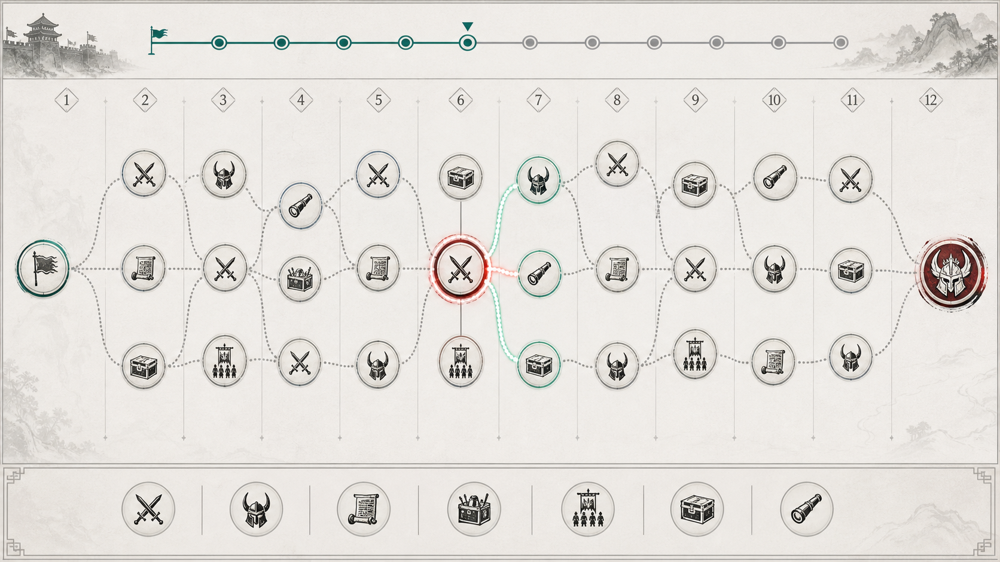

# 战役行军路径机制讨论归档 v0.1

> **状态：讨论归档，未立项、未替代现行规则。**
>
> 本文只沉淀当前对“行军路径”玩法的讨论结论、候选结构与技术表现方案，供后续决定是否正式采用时继续补充。它不改变当前“关卡 - 难度 - 波次”的配置和通关规则，不可据此直接进入程序或配置实装。

## 文档目的与当前边界

本方案探索在单局战斗中加入“行军路径”选择：玩家在备战阶段进入一张本局生成的战役节点图，在多个可达节点中选择下一步行军事件。

当前现行主规则仍为：一个关卡包含多个难度，每个难度包含配置好的敌人波次，完成该难度配置的全部波次才算通关，详见 [stage-design.md](stage-design.md)。

本讨论案仅保留以下候选方向：

- 是否将现有波次从“全部必经”调整为“战斗遭遇节点池中的可选内容”。
- 是否采用“固定行军深度 + 最终战斗”作为新的局内完成条件。
- 是否将军略、装备、招募、补给等内容纳入同一张战役图的事件节点。

以上均待后续正式决策，不得与当前关卡配置规则混用。

## 核心概念

为避免与战斗地图中的“上、中、下路”混淆，地图层面的路径统一称为“**行军路径**”或“**战役节点图**”。

| 名称 | 讨论中的含义 |
| --- | --- |
| 行军阶段 | 路线图的一列；玩家每推进一列，完成一次行军选择。 |
| 行军节点 | 某列中可选择的一个事件入口。每列随机生成 1 至 3 个节点。 |
| 战斗遭遇 | 战斗类节点触发的战斗内容。普通遭遇、精英遭遇与最终战斗可使用不同的波次数。 |
| 事件节点 | 军略提升、装备购买、招募队伍、补给整备、侦察或风险事件等非战斗内容。 |
| 路线分支 | 玩家选择一个节点后，未选的同层分支失效；后续分支允许再次汇合。 |

## 当前讨论的体验目标

- 让局内成长由“固定波次后的例行发奖”转为可预览的战役规划。
- 让小兵跨波次不自动补全、军略构筑、军资经济、队伍扩充等规则产生真实取舍。
- 保留自动战斗的主体验，同时让玩家在战斗间决定本局的风险、收益与构筑方向。
- 让同一关卡难度可以产生不同的局内行军过程，而不是仅依靠敌人数值递增。

## 路线图候选结构

### 展示与选择

- 一局开始时生成本局完整的战役节点图；玩家可预览节点事件类别、风险等级、主要收益类别与已知代价。
- 路线按从左到右的行军阶段组织；每一列节点数随机为 1、2 或 3 个，上下位置固定为上、中、下三个锚点。
- 起点固定在首列，最终战斗/Boss 固定在末列。
- 当前节点、可达节点、已走路径、未选分支与未来节点必须有明确的视觉状态区分。
- 长路线采用横向滚动或分段浏览；不应为了在单屏展示全部节点而缩小到无法识别事件图标。

### 路线长度

行军阶段数需要随关卡难度和目标局时长增长，而不是等于当前波次数。讨论中的参考范围如下，尚未定稿：

| 难度段 | 候选行军阶段数 |
| --- | --- |
| 初期/教学 | 6 至 8 列 |
| 常规难度 | 10 至 14 列 |
| 高难度 | 15 至 20 列 |

原始讨论前提为：可选行军节点总量应高于该难度的战斗波次数，以便战斗之间穿插足够的养成和策略事件。若后续采用“可跳过战斗遭遇”方案，应重新按实际局内战斗密度与局时长核算该关系。

## 事件节点候选池

下表仅代表当前讨论过的类别，不代表完整事件库或已确认数值。

| 节点类别 | 候选作用 | 讨论中的约束 |
| --- | --- | --- |
| 普通战斗 | 提供基础战功、军资、掉落或敌势控制。 | 默认建议为 1 波遭遇。 |
| 精英战斗 | 提供高风险、高收益战斗。 | 可为连续 2 波，必须在节点上提前标明。 |
| 军略提升 | 触发军略三选一、Set 解锁或定向组件机会。 | 不应与当前军略市场规则直接冲突，具体关系待定。 |
| 装备购买 | 使用局内货币购买装备或相关强化。 | 这是新局内装备方向，不能直接恢复已废除的旧战备/装备方案。 |
| 招募队伍 | 招入局内可用的英雄队长与其初始小兵队伍。 | 须先定义九队上限、满编替换、重复英雄与初始兵力规则。 |
| 补给/整备 | 补充小兵、恢复或调整局内队伍状态。 | 因小兵不会自然补全，应作为重要的生存与节奏节点。 |
| 侦察 | 提供未来节点、战斗内容或敌势的信息优势。 | 不应只是无成本的信息展示。 |
| 风险事件 | 以损失、限制或敌势换取高收益。 | 基础循环验证后再扩充。 |

## 战斗节点与跳过战斗的候选规则

### 已讨论的取舍

当前存在两种尚未定稿的方向：

1. **全部波次必经**：行军节点只改变战斗之间获得的成长事件，保留现行通关逻辑。
2. **战斗遭遇可选**：普通/精英战斗作为路径节点的一种，玩家可绕开部分遭遇；本局到达固定行军深度后进入最终战斗。

第二种方向具有更高的路线选择价值，但不能让避战变成无成本的最优解。若正式采用，需同时确认：

- 战斗节点提供其他事件不能稳定替代的战功、军资、稀有掉落或敌势控制收益。
- 选择绕开特定敌军会产生可预览的后果，例如敌势累积、后续增援或最终战强化；不得使用隐藏惩罚。
- 15 分钟局内仍须保持最低战斗密度。讨论建议为约 4 至 6 次战斗遭遇，具体以实测局时与战斗时长为准。
- 最终战斗/Boss 作为固定终点保留；普通与精英遭遇可否跳过、如何影响 Boss，待后续定稿。

## 地图随机生成候选流程

路线不采用“穷举所有整图组合”。候选实现为受约束的分层有向无环图生成：

```text
生成合法列数与每列节点数
-> 使用合法分叉/汇合模板连接相邻列
-> 分配必需事件配额
-> 按权重填充其余事件
-> 校验多样性与路径约束
-> 有限次数重抽软条件；失败时使用保底结构
```

### 硬规则

- 起点固定 1 个节点，最终 Boss 固定 1 个节点。
- 中间每列为 1 至 3 个节点；除教程、Boss 或明确的强制节点外，避免连续多列都只有 1 个节点。
- 每个非终点节点至少有一条出边；每个非起点节点至少有一条入边。
- 所有节点都必须可由起点到达，且均存在通向最终 Boss 的路径。
- 分叉与汇合限制在相邻列，避免跨多列连线或大量交叉线。
- 必需事件配额在生成时预留位置，不依赖无限重抽保证。例如每局至少出现成长、整备与一定数量的战斗机会。

### 软规则与兜底

- 避免连续多列投放同一种节点、过度线性或图形过度拥挤。
- 重抽只处理上述软规则，且必须设置有限上限，例如 10 至 20 次。
- 达到上限后直接使用已验证的保底路线结构，再按事件配额填充内容；不得出现无限循环或阻塞进入关卡。

### 节点内容生成

建议把“节点类别”和“节点具体内容”分开：

- 开局确定并展示：节点类别、风险、奖励等级、是否影响敌势。
- 抵达时再结算：军略三选一的具体结果、商店货品、招募候选与部分条件化内容。

这样既保留规划空间，也能根据抵达时的军资、队伍空位和损兵状态避免产生完全无效的商店、招募或补给选项。

## UI 表现与技术候选方案

### 当前结论

公开可查的 Y3 UI/ECA 接口资料中，未确认存在“在图片控件上动态绘制任意直线、折线或贝塞尔曲线”的能力。此处仅作为当前技术假设；正式立项前须在项目所用编辑器版本的 ECA 动作库中，以“绘制、画线、曲线、Canvas、线段、路径”等关键词复核。

因此，正式方案不应依赖把整条随机路线实时画到一张图片上。

### 推荐：列级连接片段拼接

不预制整张路线背景，也不只制作单个节点图块；预制的是“相邻两列之间的连接片段”。

```text
1 -> 1：直连
1 -> 2 / 1 -> 3：分叉
2 -> 1 / 3 -> 1：汇合
2 -> 2 / 2 -> 3 / 3 -> 2 / 3 -> 3：平行、扩展或收束
```

- 节点控件放在每列固定的上、中、下锚点，动态填充事件图标、风险、奖励、选中和禁用状态。
- 每一列之间放置一张与连接关系匹配的透明连线图片；路径变长时继续追加“节点列 + 连接片段”。
- 已走路径、当前可走路径、未选分支和未来路线可通过 normal/highlight/dim 三态连线资源或叠层实现。
- 该方案支持 6 至 20 列甚至更长路线，不会因关卡难度增长而要求制作整张更长的背景图。

“整张预制路线骨架背景图”只适合首轮体验验证；它不能作为需要动态增长路线长度的正式方案。

## 路线视觉参考

下图为本次讨论生成的概念示意，用于确认“列级节点 + 相邻列连接片段 + 状态高亮”的视觉方向。它不是最终 UI、美术资源或可直接导入的控件切片。



参考图应传达：

- 每列可有 1 至 3 个事件节点，分叉和汇合清晰可读。
- 当前节点以高亮环表现；下一步可达节点与连接路径使用强调色。
- 已放弃分支衰减；未来节点保持可预览但不过度抢占注意力。
- 事件以清晰图标区分，不依赖写死在图片中的业务文字。

## 后续需定稿的问题

1. 路线机制是否立项，以及采用“全部波次必经”还是“战斗遭遇可跳过”的完成条件。
2. 各难度的行军阶段数、实际战斗遭遇数、Boss 位置与目标局时。
3. 战功、军资、敌势之间的资源关系，以及绕开战斗的明确代价。
4. 军略市场与军略提升节点的关系，避免同一备战阶段重复出现同质选择。
5. 局内装备的完整设计、购买货币、槽位、清空规则与英雄/小兵适用边界。
6. 招募队伍的容量、替换、重复英雄、星级、初始小兵数和失败后的处理。
7. 路线图配置表结构、节点池权重、保底规则与调试工具。
8. Y3 当前项目版本是否支持动态控件创建、横向滚动及连接片段的定位/状态切换。

## 版本关系

- 本文：讨论归档，未立项。
- 当前关卡与波次主规则：[stage-design.md](stage-design.md)。
- 当前军令卡主规则：[tactical-command-card-system-v1.md](tactical-command-card-system-v1.md)。
- 若后续确认立项，应将本文件升级为正式设计案，并同步修订关卡结构、军略市场、装备、招募、UI/UX handoff 与配置表规则；在此之前不得修改上述主规则。
